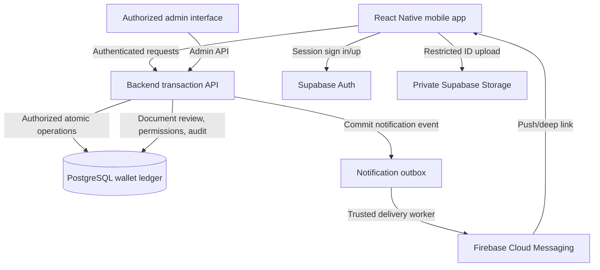

# DOUBLE UP
## Working Prototype — Full Product, Functional and Technical Specification

**Document version:** 1.0  
**Date:** 6 November 2026  
**Status:** Product baseline / implementation specification, not evidence that features have been built  
**Product:** Double Up (formerly referred to as PulaPay)  
**Audience:** Founders, co-founder/developer team, designers, backend engineers, testers and demonstration stakeholders  
**Currency:** Botswana pula (BWP), shown as P  
**Prototype operating mode:** Real accounts and persistent **test-fund** wallet transactions. No real-money custody, redemption, settlement or external financial rails until separately approved and integrated.

> **The core promise:** One registered identity. One personal wallet. Multiple ways to send, receive, pay, deposit and withdraw. A separately authorized agent has an additional operational float and agent dashboard, not a second personal wallet.

---

# 1. Executive definition

Double Up is a digital wallet and payment platform for people and businesses to exchange value within a connected network. Customers can send money to a registered phone number; receive or pay using transaction-specific QR codes and payment codes; and cash in or cash out through authorized Double Up agents. The app provides receipts, transaction histories, account notifications, identity-document collection, and administrative oversight.

The **working prototype** must operate with independently registered users, sessions, backend-enforced permissions, an authoritative shared database, ledger-backed test balances, stateful payment requests, and event-driven Firebase Cloud Messaging (FCM) notifications. It is **not** sufficient to show screens that merely increment or decrement balances on one phone.

A transport operator, student, food vendor and ordinary customer can all use a **personal wallet** for everyday financial activity. Someone approved as an agent also has a **separate agent operational account and float**. The agent role does not convert personal funds into float and does not permit free movement between those accounts.

## 1.1 Product objectives

1. Let people register, sign in and manage an identifiable, persistent account.
2. Associate one unique phone number with each customer profile for recipient discovery.
3. Allow genuine multi-user, end-to-end **test-fund** transfers that persist across sessions and devices.
4. Allow any eligible personal wallet to request and receive a QR payment, including repeated payments on a controlled reusable request.
5. Allow authorized agents to complete secure, auditable cash-deposit and withdrawal workflows.
6. Deliver FCM notifications for all relevant lifecycle and financial events without making notifications the source of truth.
7. Support ID upload, admin review and access management; use prototype-only KYC relaxation explicitly.
8. Make the UI demonstrable through Thabo, Madipu, Masego and Thabo's daughter, with coherent money movement from one actor to another.

## 1.2 Non-objectives for this baseline

- **No actual money movement** through banks, mobile-money networks or payment processors.
- No actual cash-out promise: agents hand over **demonstration cash** only in controlled test scenarios; test balances are not redeemable funds.
- No third-party cash deposit directly into somebody else's wallet.
- No NFC card payments: any future physical-card feature is outside the demonstrated core wallet workflow and would use QR/barcode scanning if later introduced.
- No unrestricted role switching or client-side permission escalation.
- No final agent recruitment, onboarding eligibility, starting float, commission, fee or funding policy until the founders decide it.
- No assumption that an FCM-delivered OTP actually verifies ownership of the claimed telephone number.

---

# 2. Status of decisions: agreed vs proposed vs undecided

**Legend:** **AGREED** = expressly decided in discussion. **DESIGN RECOMMENDATION** = engineering detail proposed to realize the agreed flow, not a new founder decision. **OPEN** = requires later product/business decision.

| Topic | Status | Requirement |
|---|---|---|
| Product name | AGREED | **Double Up**. Replace PulaPay in new UI, docs, environment labels and product copy. |
| Prototype realism | AGREED | Real registered users, central database, persistent test-fund transactions. |
| Authentication | AGREED | Email + password initially, with full name and unique linked mobile number. |
| OTP transport | AGREED (prototype) | Simulated OTP delivered through FCM. Future phone proof by an appropriate real verification channel. |
| ID verification | AGREED | Upload after registration; admin reviews; **pending review does not block prototype test transactions**. Production must require applicable identity checks before regulated transactions. |
| Main personal wallet | AGREED | One personal wallet per user, regardless of ordinary occupation. |
| Agent access | AGREED | Approved agent can use own customer dashboard and agent workspace; operational float separate. |
| Other dashboard access | AGREED | Drivers and service providers use the standard personal account interface. Approved agents switch only between Personal and Agent. Admin uses a restricted admin interface. No global role switcher. |
| QR Receive | AGREED | Starts as one-payment request; after first successful payment receiver chooses **Complete** or **Reuse**; Reuse sets number of **additional successful payments**. |
| Parallel QR requests | AGREED | Multiple independent active receive requests, each with its own visible counter and limit. |
| Send | AGREED | Enter phone; resolve recipient name; review amount and name; confirm; atomic transfer. |
| Withdrawal | AGREED | Customer creates amount-specific code; agent enters customer number + code; customer receives explicit **Approve / Decline** in-app request; declined code cancelled. |
| Deposit authorization | AGREED | Agent enters customer's phone and amount, confirms cash receipt; customer's FCM OTP alone authorizes the deposit; **no second app approval**. |
| Deposit destination | AGREED | Customer can deposit **only into own wallet**. To fund someone else, deposit into own wallet first, then use Send Money. |
| Agent float | AGREED in concept | Deposit reduces agent float and increases customer personal wallet; withdrawal reverses that wallet direction after proper authorization/handover. |
| Notifications | AGREED | Use FCM for significant account, payment, transfer, deposit, withdrawal and admin events. |
| Self-top-up from external rails | OPEN | Future feature; exact bank/mobile-money/card funding channel and settlement model not selected. |
| Agent eligibility, float provisioning, thresholds, commissions | OPEN | Do not hardcode unapproved business policies. |
| Fees, transfer and withdrawal limits, OTP lifetime | OPEN / CONFIGURATION | Use configurable values for test; do not present chosen test values as business policy. |
| QR expiration and post-first-payment decision timeout | DESIGN RECOMMENDATION | Apply configurable expiry and safe pending state so a QR cannot remain unintentionally open. |

---

# 3. Product mental model: identity, capabilities, accounts and sessions

A frequent architectural mistake is treating **customer**, **driver**, **vendor** and **agent** as inherently different money stores. Double Up separates four layers:

1. **Identity**: one unique registered human with full name, email, linked phone number, authentication and profile.
2. **Capability / authorization**: what this individual may do, e.g. send money, receive payments, process deposits, or review IDs.
3. **Financial account**: where the balance and movements are recorded: personal wallet, or a separately authorized agent operational float.
4. **Workspace/dashboard**: a suitable interface for the user's approved responsibilities, without creating another personal wallet.

**Examples:** Thabo is a driver and father, yet passenger fare income, purchases and family transfers all use Thabo's single personal wallet. Madipu sells food and receives P20 into her personal wallet. Masego sells nail services using her personal wallet and, after authorization, uses her **separate agent float** exclusively for customer cash operations.

## 3.1 Functional actors

| Actor | Main activities | Funds affected | Dashboard rule |
|---|---|---|---|
| Ordinary customer | Register, pay, receive, send, deposit own funds, withdraw, check history | Own personal wallet | Customer only |
| Driver (Thabo) | Receive transport fare QR payments, plus ordinary wallet activities | Own personal wallet | Uses the standard personal account interface; no Driver workspace |
| Service provider/vendor (Madipu) | Receive payment for products/services, plus ordinary wallet actions | Own personal wallet | Uses the standard personal account interface; no Provider workspace |
| Approved agent (Masego) | All own personal activities **and** process approved customer cash deposits/withdrawals | Personal wallet **or** agent operational float, never mixed | May switch only between own customer and agent dashboards |
| Administrator | Review uploaded documents, account flags, agent permissions, monitor records, handle disputes | No arbitrary wallet writes | Authorized admin workspace |
| System backend | Enforce authorization, ledger transfers, request states, OTP validity, notification jobs | All ledger operations via approved secure routines | Not a human role |

**Role note:** Driver, vendor, and service provider describe how a person uses the wallet; they do not create separate app workspaces or personal balances. Only an approved agent receives an additional Agent mode and separate operational float. An agent can optionally sell services personally without routing that income through agent float.

## 3.2 Common rule for profile and phone lookup

- Normalize phone numbers to an unambiguous format, e.g. E.164 (`+267...`), before storage/search.
- Enforce unique phone association at the database layer. Do not allow two active registered identities to claim the same number.
- Show the **confirmed account display name** to the sender before payment, while minimizing disclosure in unrestricted lookups (rate limit, avoid bulk phone enumeration).
- Changing a phone number must eventually require a trusted re-verification procedure; do not make it a simple editable profile field that silently reassigns a payment destination.

---

# 4. User lifecycle and screens

## 4.1 Screen inventory

| Area | Screens | Required primary actions |
|---|---|---|
| Launch | Splash, welcome, onboarding | Establish session, show feature introduction |
| Authentication | Register, Sign in, password reset, email verification if configured | Create and authenticate account |
| Phone verification (simulated) | Phone entry, request OTP, OTP entry, success/failure | Test FCM delivery and server-side code validation |
| Profile | Complete profile, ID upload, verification status, settings | Upload documents and review status |
| Personal/role dashboard | Wallet balance, action shortcuts, recent transactions | Navigate Send, Pay, Receive, Deposit, Withdraw |
| Send | Recipient number, recipient preview, amount, review/confirm, receipt | Name-verified wallet transfer |
| Pay | QR scanner, enter payment code, payment review, receipt | Resolve request and approve transaction |
| Receive | Service/description and amount, generated QR/code, initial payment result, Complete/Reuse choice | Create and control payment requests |
| Payment requests | Active / pending decision / completed / expired list; details and counters | Reopen QR, review payments, close active request |
| Cash deposit (customer) | How to deposit, verification notification, deposit receipt/history | Guidance and OTP reception; no direct third-party cash-in |
| Cash withdrawal (customer) | Amount, temporary code, pending approval, approve/decline, handover status, receipt | Control agent cash-out request |
| Agent | Agent overview, float, Process Deposit, Process Withdrawal, verify OTP/code, handover completion, history | Operate only with authorized agent permissions |
| Notifications | Inbox, detail, deep link to transaction/approval | Track lifecycle and action requests |
| Admin | Login, users, document review, agent permissions, transactions, holds/disputes, audit | Controlled oversight |
| Error/edge states | Offline, expired session, insufficient funds, duplicate attempt, cancelled/expired code | Recover safely without double posting |

## 4.2 Registration flow: account is real, phone OTP is simulated

1. User opens splash screen; app checks a valid authenticated session.
2. New user sees onboarding and chooses **Create Account**.
3. Enter **first name, last name, mobile number, email, password, confirm password**; accept applicable terms.
4. Frontend validates required fields and password rules; backend enforces unique email/auth identity and normalized unique phone.
5. Create the authenticated Supabase user and corresponding profile **without exposing any privileged credentials** in the app.
6. Create a **personal wallet** exactly once, linked to authenticated user ID; initial balance is zero unless seeded through a controlled test ledger operation.
7. Generate a **phone-verification simulation challenge** (limited attempts and expiry); FCM delivers the code to a registered app installation.
8. User enters the code; backend marks `phone_verification_mode = prototype_fcm`, `phone_verification_status = simulated_verified` if correct. **Do not label this as real SMS-verified phone ownership.**
9. User lands on **Complete Profile / Upload ID**; can upload identity images to a private restricted storage location.
10. Identity status is `not_submitted`, `pending`, `approved` or `rejected`; admin may review and record decision/reason.
11. **Prototype:** continue to test wallet dashboard regardless of pending ID review. **Production:** block regulated actions until required ID review/compliance conditions are met.
12. Log all key lifecycle events and notify as appropriate.

### 4.2.1 Registration acceptance tests

- Two accounts cannot claim the same normalized phone number.
- An unverified app can **simulate** an OTP flow, but the system never describes FCM verification as proven control of SIM/phone number.
- Closing and reopening the app restores session and same wallet, not a fresh balance.
- Wallet creation is idempotent; failed/retried registration cannot create two personal wallets.
- Documents are not publicly accessible; admins can see only documents their role permits.

---

# 5. Main financial scenarios: Thabo, Madipu, Masego and daughter

This section is the most important shared demonstration script. Follow the same actors across **separate accounts/devices or sessions** so observers can see money moving across the ecosystem.

## 5.1 Demo actors and opening test balances

These values are **example seeds** used only to make the demo reproducible; they are **not** approved fees, agent policy or real money.

| Actor | User ID / account | Suggested initial personal test balance | Suggested agent float |
|---|---|---:|---:|
| Thabo | Registered driver | P100.00 | None |
| Madipu | Registered vendor | P50.00 | None |
| Masego | Registered individual + explicitly approved agent | P75.00 | P1,000.00 **test-funded by admin-controlled initialization** |
| Thabo's daughter | Registered ordinary user | P25.00 | None |
| Passenger A / Passenger B | Registered customers | P30.00 each | None |

**Seed method:** Use a controlled, audited test-fund issuance source account in the ledger. Do not set balance fields directly through client code or grant users arbitrary top-up privileges.

## 5.2 Scenario A — Thabo receives a transport fare, then reuses the QR

**Story:** Thabo drives a combi and wants to collect P7 per passenger.

**Initial request**

1. Thabo signs into his driver interface with his registered identity.
2. Select **Receive**; enters `Combi transport` and P7.00.
3. Backend creates `payment_request R1`: owner=Thabo, amount=P7, description, status=`active_initial`, successful payments initially 0; QR and code resolve to **R1**.
4. Passenger A opens Pay → Scan QR, or enters R1's payment code.
5. Passenger A sees recipient Thabo, description and P7, and selects **Confirm**.
6. Backend atomically debits Passenger A P7, credits Thabo P7, records ledger and receipt, and marks R1's first successful use.
7. R1 changes to `awaiting_receiver_choice`: **do not automatically accept a second payment until Thabo decides**.
8. Thabo receives FCM and in-app prompt: **Payment received: P7. Complete or Reuse?**

**Complete path:** Thabo chooses Complete; R1 becomes `completed`; further scans show a non-payable request without debiting the scanning customer.

**Reuse path:**

9. Thabo chooses **Reuse**, enters `30 additional payments`, and confirms. R1 becomes `active_reusable` with `additional_limit = 30` and `additional_success_count = 0`.
10. Passenger B and later customers scan **the same QR**; each sees Thabo + P7 and individually approves payment.
11. For each successful additional payment, backend adds 1 to `additional_success_count` **within the same transaction/lock** that executes wallet movement.
12. The UI can show `12 / 30 additional payments received`, as well as `13 total payments` (initial 1 + additional 12). These labels must not be conflated.
13. When the 30th **additional** payment posts, R1 becomes `completed`; total allowed successful payments = **31** (1 initial + 30 additional). Failed/cancelled attempts do not consume a slot.
14. Thabo can also manually close R1 before the limit; receipts/history remain searchable after closure.

**Critical concurrency rule:** If two passengers attempt the last available slot at the same time, only one succeeds. The other gets an `request full/closed` response and **no debit**. Protect this server-side with locking/serialization and a unique idempotency reference.

**Unanswered business parameter:** QR expiration window is configurable; prototype can demonstrate expiration without implying the chosen duration is production policy.

## 5.3 Scenario B — Thabo buys a P20 hot dog from Madipu

1. Madipu selects **Receive**, enters `Hot dog` and P20, creates QR request R2.
2. Thabo selects **Pay**, scans R2's QR or enters payment code.
3. App displays: `Pay P20.00 to Madipu for Hot dog?` with **Confirm** and **Cancel**.
4. Thabo confirms; backend verifies wallet balance and R2 is payable.
5. Backend posts an atomic transfer **Thabo personal −P20; Madipu personal +P20**.
6. Both receive notification and receipt; Madipu is prompted **Complete or Reuse** because this was R2's first success.
7. Madipu chooses Complete if only one hot dog payment is needed; or Reuse for a selected number of **additional** sales.

**Example balance movement:** If Thabo began with P100 and earned P7 first, he has P107; after buying the hot dog he has **P87**. Madipu starting at P50 now has **P70**. This assumes no fees and no other transactions.

## 5.4 Scenario C — Thabo sends P200 to his daughter

1. Thabo opens **Send Money**.
2. Enters daughter's registered phone number, normalized by backend.
3. App resolves and displays her verified account display name; do not proceed silently based on phone alone.
4. Thabo enters P200; confirmation shows recipient name, masked phone, amount and any configured fee (if any).
5. Thabo confirms; backend checks available funds and account status, generates transfer reference, and atomically debits him / credits daughter.
6. Daughter gets `You received P200 from Thabo`; Thabo gets `You sent P200 to [recipient]`.
7. Both can reopen the same receipt; transfer cannot execute twice on retries.

**Balance note:** With only P87 after Scenario B, Thabo **cannot yet send P200**. The demo must either first show Thabo receiving more fare payments, performing a deposit into his own wallet, or seed him with sufficient test funds. This is a necessary real-world consistency check, not an inconvenience to bypass.

## 5.5 Scenario D — Thabo withdraws cash at authorized agent Masego

**Customer preparation**

1. Thabo opens **Withdraw** and enters, for example, P60.00.
2. Backend checks available funds and creates withdrawal W1 associated with **Thabo + amount P60**, with a short-lived, single-use authorization code. In implementation, keep only a secure hash of the code, track expiry/attempts and rate-limit validation.
3. Customer screen displays the withdrawal code and status `Awaiting agent`; no cash is transferred merely because the code exists.

**Agent initiates**

4. At the counter, Masego opens **Agent → Process Withdrawal**.
5. She enters Thabo's linked phone number and W1 code.
6. Backend checks that Masego is an authorized active agent, that W1 is valid, belongs to Thabo, has not expired/been used, and matches the pending amount.
7. Backend creates a customer-approval challenge; Thabo receives FCM and can also see it in-app if FCM delivery is delayed.
8. Thabo's screen reads, for example: `Masego (Double Up agent) requests to withdraw P60.00 from your wallet. Approve or Decline?`.
9. **Decline:** mark W1 `declined/cancelled`, invalidate code, cancel any held funds; do not transfer value or hand out cash.
10. **Approve:** backend reserves the customer's P60, prevents double spending, and marks W1 `approved_pending_handover`. **Approval is not itself evidence that physical cash was given.**

**Cash handover and settlement**

11. Masego verifies that she has enough physical cash for this request; hands Thabo P60 only after approval and following the agreed handover control.
12. An agent-side **Cash Handed Over** action records the actual handover. Backend finalizes atomically: Thabo's reserved P60 becomes a debit and Masego's agent **operational float gains P60** (a record of the value transferred back into agent float). Maintain appropriate physical cash-drawer accounting separately.
13. Both receive completed receipts. If cash handover fails, perform controlled cancellation/release or admin-review workflow, **not an invisible unilateral reversal**.

**Why reserve before handover?** A naïve flow that debits Thabo as soon as he taps Approve can leave the customer without cash if the agent cannot pay. A hold + explicit finalization makes failure handling and reconciliation visible. The precise handover evidence and dispute policy are DESIGN RECOMMENDATIONS pending operational policy.

## 5.6 Scenario E — Thabo deposits P300 cash into **his own** wallet

1. Thabo physically visits Masego and gives her P300 in cash.
2. Masego signs into her **agent workspace**, chooses **Process Deposit**, enters **Thabo's** registered phone number.
3. Backend returns Thabo's account display name; agent checks she selected the intended customer.
4. Masego enters P300 and confirms **Cash Received**; backend validates that her **agent float** has at least P300 available.
5. Backend creates deposit request D1 (customer=Thabo, agent=Masego, amount=P300) and generates an **amount-, customer-, agent- and transaction-bound OTP**, limited by attempts/expiry.
6. Thabo receives OTP **through FCM** on his Double Up device; this simulates the intended verification process.
7. Thabo gives Masego the OTP; **OTP alone is sufficient authorization**. There is **no second customer Approve button** for deposits.
8. Masego enters OTP; backend validates the OTP and request state.
9. Server atomically **debits Masego agent operational float P300** and **credits Thabo personal wallet P300**, records ledger, clears/consumes OTP, and marks D1 completed.
10. Thabo and Masego receive FCM notifications/receipts; Masego retains the physical P300 cash and her separately tracked cash drawer increases.

**Failure paths:** Wrong OTP → no transfer; expired OTP → no transfer; depleted float → no transfer; duplicate OTP submission → original outcome returned but not applied again; no FCM delivery → retry/resend within limits; no actual cash received → deposit must not be confirmed.

**Security note:** OTP delivery by FCM authenticates access to a device/app installation, **not real ownership of the registered phone number**; this is acceptable only for the explicitly labeled test-fund prototype. No user may remotely call `completeDeposit` without the authorized agent context and transaction-specific validation.

## 5.7 Scenario F — Thabo wants to give his daughter cash through Double Up

**Direct cash deposits to another person's wallet are not allowed in Version 1.0.** Thabo cannot ask Masego to type his daughter's number and deposit the cash directly to her account.

Correct path:

1. Thabo deposits P200 cash **into his own wallet** using Scenario E (with OTP delivered to Thabo).
2. Once it shows as available in his personal wallet, Thabo opens **Send Money**.
3. He enters daughter's registered phone number, verifies her displayed name, enters P200 and confirms.
4. Backend transfers P200 from Thabo to daughter (Scenario C), with independent transfer reference and receipts.

This creates **two separate ledger transactions**: `agent cash-in` and `customer-to-customer send`. Do not disguise them as a direct third-party deposit.

## 5.8 Scenario G — Masego is both a nail technician and an agent

1. Masego has one registered identity and one **personal wallet**.
2. Her customer pays P100 for nails via Masego's ordinary **Receive** QR; the P100 appears in Masego's **personal** wallet.
3. An administrator grants Masego active agent authorization after the separately defined agent approval process.
4. She gains a second **agent dashboard** and **agent operational float**, without receiving a second personal account.
5. The P100 nail income remains personal money; it cannot be silently treated as agent float.
6. When she processes Thabo's P300 deposit, agent float decreases P300; her personal wallet does **not** decrease.
7. When she processes a completed P60 withdrawal, agent float increases P60; her personal wallet does **not** increase.
8. Personal and agent history, totals and available balances are displayed separately, with an auditable cross-reference to customer transaction IDs.

## 5.9 Illustrative end-to-end ledger walk-through

The following is a **single coherent example** with test funds and **no fees**. Start from the example opening balances in 5.1. To fund the family transfer, Thabo first deposits P200 into his wallet at Masego's agent account.

| Step | Event | Thabo personal | Madipu personal | Daughter personal | Masego personal | Masego agent float |
|---|---|---:|---:|---:|---:|---:|
| 0 | Example opening balances | P100 | P50 | P25 | P75 | P1,000 |
| 1 | Passenger A pays Thabo P7 fare | P107 | P50 | P25 | P75 | P1,000 |
| 2 | Thabo buys Madipu's P20 hot dog | P87 | P70 | P25 | P75 | P1,000 |
| 3 | Thabo deposits P200 of his own cash through Masego | P287 | P70 | P25 | P75 | P800 |
| 4 | Thabo sends P200 to his daughter | P87 | P70 | P225 | P75 | P800 |
| 5 | Thabo withdraws P60 at Masego, after approval and handover | P27 | P70 | P225 | P75 | P860 |
| 6 | Thabo later deposits P300 of his own cash at Masego | P327 | P70 | P225 | P75 | P560 |
| 7 | Customer pays Masego P100 for nails | P327 | P70 | P225 | P175 | P560 |

**Conservation check:** Across these five displayed financial accounts, the total begins at P1,250 and ends at P1,250, **excluding passenger A and other counterparties**. After passenger A pays P7, the five displayed accounts collectively gain P7 while Passenger A's personal wallet loses P7. Across **all** included ledger accounts, value is conserved. A real test suite must verify the conservation invariant over **both sides** of every transfer, including seed/source and any fee account.

> Physical cash is an off-ledger asset in the prototype's digital-wallet ledger model and should be tracked through cash-drawer/operational records. Cash received during a customer deposit should not be mistaken for a second credit to the agent's digital float.

---

# 6. Formal workflow states and transition rules

## 6.1 Receive / reusable QR lifecycle

| State | Allowed actions | Transition |
|---|---|---|
| `active_initial` | One successful first payment | `awaiting_receiver_choice` after success |
| `awaiting_receiver_choice` | Receiver selects Complete or Reuse | `completed` or `active_reusable` |
| `active_reusable` | Pay while `additional_success_count < additional_limit`; owner may close | `completed` when limit reached or owner closes |
| `completed` | Read-only QR/receipt/history | Terminal; cannot collect further payments |
| `expired` | Read-only, explain expiration | Terminal; cannot collect payments |
| `cancelled` | Owner cancels before qualifying use or admin controls | Terminal; no new payments |

**Counter semantics:** `initial_success_count` is 0 or 1; `additional_limit` is the *number of additional successes* chosen **after** the first payment; `additional_success_count` starts at 0. Display both `X/Y additional` and total successes where useful. The max additional limit should be capped by a configurable safety limit.

**Owner cannot modify** recipient, amount, service or QR destination after any payment has succeeded; create a new request instead. Owner can create multiple requests in parallel.

## 6.2 Send transaction lifecycle

`draft_client` → `recipient_resolved` → `awaiting_sender_confirmation` → `processing` → `completed` or `failed`.

The frontend confirmation is an intentional user action. The backend still checks sender identity, balance, account status, recipient availability, amount validity, limits and idempotency. A failed attempt must never partially post ledger entries.

## 6.3 Withdrawal lifecycle

`created` → `agent_presented` → `awaiting_customer_approval` → (`declined` **or** `approved_pending_handover`) → (`completed` **or** `handover_failed/requires_review`).

Expiry/cancellation may terminate eligible pending stages. One code cannot be reactivated after decline, expiry or completion. Approved pending withdrawals must reserve funds so balance is not double-spent. Any exception must be reconciled explicitly.

## 6.4 Deposit lifecycle

`agent_draft` → `customer_identified` → `cash_received_confirmed` → `otp_sent` → `awaiting_otp` → `completed`.

Alternative terminal statuses: `cancelled`, `expired`, `rejected`, `failed`. No ledger transfer before successful backend OTP validation. OTP can be used only once and only for the exact agent, customer, amount and request reference. No second in-app customer approval is required.

---

# 7. Technical architecture and source of truth

## 7.1 Proposed stack

- **Mobile:** React Native + Expo, TypeScript.
- **Authentication:** Supabase Auth (email/password for the prototype).
- **Database:** Supabase PostgreSQL, transactional ledger, uniqueness constraints and Row Level Security (RLS).
- **Server logic:** authenticated backend functions / application service; use single-transaction SQL routines for critical money movement after identity and permission checks.
- **Storage:** private Supabase Storage buckets for ID uploads, no public document links.
- **Notifications:** Firebase Cloud Messaging delivered from a trusted backend using device tokens and notification outbox.
- **Administration:** protected web admin or restricted admin app, access bound to actual server-side roles.
- **Testing:** isolated staging/test environment, deterministic test seed and end-to-end scripts across multiple test users.

**Important:** No balance mutation, agent permission grant, OTP secret, privileged database API key, or FCM server credentials may reside in app client code. FCM is a delivery channel, not an authoritative transaction processor. Supabase Realtime/polling can synchronize current status, but it does not replace posting ledger entries.

## 7.2 Architecture diagram

## 7.3 Suggested database model

The following logical schema is a **starting design**, not a migration already run. Add created/updated timestamps, server-enforced ownership, foreign keys, unique indices, audit fields, currency and appropriate status constraints.

| Entity | Key fields | Constraints / purpose |
|---|---|---|
| `profiles` | `id = auth user`, first_name, last_name, normalized_phone, verification_mode/status, kyc_status | One account identity; unique phone; don't treat client-controlled metadata as authorization |
| `user_capabilities` | user_id, capability, active, approved_by, approved_at | Server-owned permissions; only admin can issue agent authorization |
| `wallet_accounts` | id, user_id, wallet_type (`personal`/`agent_float`), currency, status | Exactly one personal wallet per user; agent float only where approved |
| `ledger_transactions` | id, kind, reference, idempotency_key, actor, status, created_at | Parent transaction including receipts and traceability |
| `ledger_entries` | id, transaction_id, wallet_id, debit_or_credit, amount_minor_units | Every completed movement has balanced postings; no floats for money |
| `wallet_holds` | id, wallet_id, withdrawal_id, amount_minor_units, expires_at, status | Reserve funds during withdrawal approval/handover |
| `payment_requests` | id, owner_id, amount_minor_units, description, code, state, first_success, additional_limit, additional_success_count, expires_at | Stable QR/code reference and atomic reuse control |
| `payment_attempts` | id, request_id, payer_id, transaction_id, idempotency_key, state | Attempts separate from **successful** counted payments |
| `withdrawal_requests` | id, customer_id, agent_id, amount_minor_units, code_hash, expires_at, attempts, state, hold_id, confirmed_at, handover_at | Separate token validation, customer approval and cash handover |
| `deposit_requests` | id, customer_id, agent_id, amount_minor_units, otp_hash, expires_at, attempts, cash_confirmed_at, state | OTP validates only exact deposit; customer is registered wallet owner |
| `identity_documents` | id, user_id, private_storage_path, document_type, review_status, reviewer_id, reviewed_at | Private documents and administrative review |
| `device_registrations` | id, user_id, device_identifier, fcm_token, revoked_at, last_seen | Multiple devices; remove invalid tokens and revoke on logout |
| `notification_outbox` | id, event_type, subject_id, recipient_user_id, payload_ref, status, attempts | Guaranteed queued intent after committed state; retryable delivery |
| `notifications` | id, user_id, type, message, deep_link_ref, read_at, delivered_at | In-app history independent of whether FCM arrives |
| `agent_cash_drawer` (optional test ops) | agent_id, opening_cash, cash_in, cash_out, observed_balance, discrepancy | Reconcile physical-demo cash vs float; separate from ledger |
| `audit_events` | id, actor_id, action, resource_type, resource_id, before/after refs, reason, timestamp | Immutable sensitive changes and role reviews |

**Money representation:** store integer minor units (thebe) and currency code, e.g. P7.00 = 700 minor units. Never rely on binary floating-point arithmetic for monetary values.

**Ledger invariant:** For any completed transfer T, the sum of debits equals sum of credits in the same currency; the database commits both or neither. Protect against negative *available* balances except where specifically allowed by an approved, separate policy.

**Balances:** balances shown in app must derive from or be consistent with posted ledger entries and active holds. If a cached balance is maintained for performance, update the cache transactionally with the ledger, never independently from the mobile client.

## 7.4 Illustrative API contracts

These are **suggested endpoint capabilities**, not a claim that they currently exist:

| Operation | Request essentials | Backend responsibility |
|---|---|---|
| `POST /profile/register-phone` | logged-in user, normalized phone | Enforce uniqueness; issue simulated verification challenge |
| `POST /verification/phone/confirm` | challenge ID, OTP | Validate attempt/expiry; label simulation correctly |
| `POST /receive-requests` | description, amount | Create own payable QR/code; server-owned recipient |
| `GET /receive-requests/{id}` | request reference | Show safe details; no private secrets |
| `POST /receive-requests/{id}/complete` | owner confirmation | Close only own request |
| `POST /receive-requests/{id}/reuse` | `additional_limit` | Only after first success and from pending-decision state |
| `POST /payments/confirm` | request ID, idempotency key | Authorize payer; atomically move value and count success |
| `GET /recipients?phone=...` | normalized phone | Rate-limited recipient name preview |
| `POST /transfers` | recipient, amount, idempotency key | Single atomic send after sender confirmation |
| `POST /withdrawals` | amount | Create user-bound, expiring withdrawal code |
| `POST /agent/withdrawals/present` | customer phone, code | Verify agent + request; ask customer to approve |
| `POST /withdrawals/{id}/decision` | approve/decline | Only actual customer may decide; reserve or cancel |
| `POST /agent/withdrawals/{id}/handover` | cash handover evidence | Finalize or flag for review |
| `POST /agent/deposits` | customer phone, amount, cash-received confirmation | Authorized agent initiates own-wallet deposit and OTP |
| `POST /agent/deposits/{id}/otp` | OTP, idempotency key | Validate transaction-bound OTP; atomically post float → customer |
| `GET /wallet/transactions` | authenticated scope, pagination | Own personal or authorized agent history, never others' |
| `POST /admin/agent-access` | target user, action, reason | Only authorized admin may grant/revoke |
| `POST /admin/kyc-review` | document/user, decision, reason | Controlled review and audit |

**Authentication:** Each call obtains the caller identity from a trusted session. Never trust client-submitted `sender_user_id`, `agent_role`, or `owner_id` as proof of permission.

**Idempotency:** A retry with the same idempotency key and same payload returns the original outcome, not another debit. Reuse of a key with a different payload must fail. Use unique database constraints and transaction locking, not just frontend button disablement.

## 7.5 Suggested QR payload

The QR should contain an opaque, unguessable payment-request reference or signed/deep-link URL to that request, **not** the recipient's password, OTP, wallet secret or editable balance. Server resolves the request and enforces its actual amount, beneficiary, remaining uses and status. A QR screenshot can be reused only as long as the backend says it is payable.

## 7.6 Event and notification model

**Event triggers:** account created, phone simulation code sent, ID submitted/reviewed, receive request created, payment succeeded/failed, receive request reuse configured/completed, transfer sent/received, withdrawal approval requested/approved/declined/completed, deposit OTP sent/deposit completed/failed, and relevant administrative account actions.

**Delivery pattern:** Backend commits state and writes an outbox event in the same database operation; a trusted delivery worker dispatches FCM, retries transient failures, and records send status. The app has an inbox and refresh/status endpoint so a missed notification cannot make balances wrong or block recovery.

**OTP handling:** OTPs are short-lived, random, hashed at rest, attempt-limited, scoped to an exact action and one-time use. Avoid placing codes in broad push-preview surfaces for production; the simulated FCM OTP is restricted to test-only behavior. Deep-link withdrawal alerts open the authenticated approval screen and require current server-side state checks.

---

# 8. Security, permissions, privacy and operational safeguards

## 8.1 Backend access and database policy

- Enable RLS on every exposed personal-data table. Read access must be scoped to the authenticated user or specifically authorized agent/admin.
- Server-side agent authority is an administrative permission, **not** a user-editable profile field or client-accessible role switcher.
- Ordinary users may view only their wallet/transactions; agents may view only operational requests allocated/initiated by their agent identity; administrators have least-privilege scopes.
- Store privileged backend keys only on the trusted server. Never ship database service keys or Firebase service-account secrets to an Expo build.
- Keep OTP code hashes, security attempts, internal dispute notes and private identity documents inaccessible to ordinary Data API reads.
- Security-definer database functions, if required for atomic ledger posting, must have explicit caller authorization, restricted execution grants, safe object qualification, and security review.
- Allow password reset and session termination; invalidate or expire sensitive pending actions when appropriate.

## 8.2 Fraud/error scenarios to handle

1. QR was paid once and is awaiting owner's Complete/Reuse choice: second payer must be refused with a clear state, **not charged**.
2. QR limit reached while concurrent scan attempts are in flight: never overspend cap or double charge.
3. Payer double-taps Confirm / API times out: idempotent receipt, one debit only.
4. Customer insufficient balance: no credit to recipient, no counter increment.
5. Agent enters a phone number for an unregistered user: explain not found, do not create a shadow wallet.
6. Agent has insufficient float for deposit: block before OTP issue or before final settlement; do not credit customer.
7. Wrong, expired or already-used OTP: reject without partial transfer.
8. Withdrawal code known to an attacker: cannot cash out without actual customer approval; decline permanently invalidates code.
9. Withdrawal approved but agent cannot produce cash: hold is not incorrectly posted as completed; follow visible cancellation/review.
10. User switches agent UI to personal UI: balances and transaction history remain isolated, with backend permissions rechecked.
11. Duplicate phone claim or changed number: prevent ambiguous transfers and account takeover.
12. FCM unavailable or delayed: transaction state still accessible and trustworthy in app; never infer success/failure from a push alone.
13. Two agents attempt same withdrawal code: first valid presentation reserves the request, second is rejected.
14. Admin permission revoked during request: no new sensitive action succeeds unless currently authorized.
15. ID documents or audit data requested by another user: unauthorized access blocked and logged.

## 8.3 Prototype versus real-money deployment boundary

All test wallets must be visually labeled `TEST FUNDS — NOT REAL MONEY` in demonstration environments. Test-fund issuance is a restricted admin/tool action with audit, and no redemption for actual cash. Cash-in/cash-out demonstrations must not be represented as a live customer financial service. Before real-money operations, separately establish legal/regulatory permissions, bank/mobile-money integrations, safeguarding/settlement arrangements, customer support, fraud operations, KYC/AML requirements, fees and reconciliation.

---

# 9. UX and screen-level behavior requirements

## 9.1 Dashboard and navigation

- Display the account name and the authorized Personal, Agent, or Admin context.
- Show **personal wallet available balance** prominently. Agent dashboard shows **operational float** separately, with clear label and context.
- Personal Home quick actions are Send, Pay, Receive, Deposit, and Withdraw. History is available through Activity.
- Recent activity includes payer/recipient, amount, service or reference, timestamp and status.
- Do not expose unauthorized dashboard switching. Agent sees a clear `Switch to Personal / Switch to Agent` control only for those two views.
- Every bottom navigation configuration contains no more than five buttons and follows `docs/NAVIGATION.md`.
- Personal navigation is Home, Pay, Requests, Activity, and Profile.
- Agent navigation is Overview, Deposit, Withdraw, Activity, and Profile.
- Admin navigation is Overview, Users, Reviews, Transactions, and More.
- Driver and provider workspaces are not part of Double Up.

## 9.2 Confirmations must prevent mistakes

- **Pay:** recipient, service, amount, confirmation button. Never assume scanning alone authorizes payment.
- **Send:** recipient's name resolved from number, masked phone, amount and fee if applicable. Never send directly from phone entry.
- **Deposit agent:** intended customer's name, normalized/masked phone, amount, cash-received check; only then issue OTP.
- **Withdrawal customer:** agent's displayed identity, requested amount and Approve/Decline. No money movement solely from agent code input.

## 9.3 Receipt requirements

Receipts show transaction/reference ID, type, amount, direction, relevant other party, description where relevant, date/time, status, and whether value is **test funds**. Avoid revealing full private phone numbers or identity documents. A completed receipt remains available on both relevant accounts after app restart.

## 9.4 Error copy examples

- `Insufficient balance. You need P113.00 more to send P200.00.` (when available is P87)
- `This payment request is waiting for the receiver to choose Complete or Reuse.`
- `This QR code has reached its allowed number of payments.`
- `This withdrawal code has expired. Generate a new one.`
- `The customer declined this withdrawal. No funds were transferred.`
- `Invalid or expired deposit OTP. No deposit was processed.`
- `This phone number is not registered with Double Up.`
- `You can only deposit into your own wallet. Deposit into your wallet, then Send Money.`
- `Network unavailable. Transaction status is not yet confirmed. Check Activity before retrying.`

---

# 10. Administrative and agent operations

## 10.1 Admin dashboard modules

1. **Overview:** number of registered test users, test transaction volumes, success/failure, pending ID reviews, authorized agents.
2. **Users:** search by user ID/name/phone (permission controlled), statuses and associated account metadata.
3. **ID review:** secure document viewer, approve/reject with reason, timestamps and reviewer ID; no blocking for pending ID in prototype.
4. **Agent authorizations:** grant/revoke agent capability with reason and audit; create/disconnect operational float according to separately approved business policy.
5. **Transactions:** read-only investigation by reference, participant, type, status and time; no unlogged balance edits.
6. **Disputes and exceptional states:** expired OTPs, approved-withdrawal no-cash cases, failed FCM delivery, reconciliation issues.
7. **Test-fund administration:** controlled seed/test-reset workflow, never normal production user top-up.
8. **Audit:** immutable history of agent access, reviews, test funding, cancellations and reversals.

## 10.2 Agent operations and float reconciliation

- Agent float is an **operational digital account**, not personal wealth and not a mirror of physical cash.
- **Deposit:** customer gives physical cash; agent digital float goes **down**, customer wallet goes **up**; agent physical drawer goes **up**.
- **Withdrawal:** agent gives physical cash; customer wallet goes **down**, agent digital float goes **up**; agent physical drawer goes **down**.
- For a balanced operational picture, record both digital float and physical cash activity, and show any variance for review.
- A business policy is required later for who can become an agent, how agent float is funded/rebalanced and minimum cash/float thresholds. Do not invent these values.

---

# 11. Migration plan from co-founder's existing prototype

The source code has **not** been supplied or audited for this document. The items below are **required alignment checks**, not claims about exact code defects.

| Current/prototype pattern to inspect | Desired change | Definition of done |
|---|---|---|
| Hardcoded demo users | Real sign-up/sign-in in central database | New user registers and signs in on another device/session |
| Frontend-only balances | Server ledger posting | Reopen both accounts and see same committed balances |
| Occupation-specific personal wallets | One personal wallet per identity | Driver, vendor and ordinary transfers all affect same user's personal wallet |
| Global role switcher | Authorized role-specific navigation | Customer cannot open agent/admin; agent only personal ↔ agent |
| Agent float mixed with customer funds | Separate operational account and history | Personal sale does not alter agent float; cash operation does not alter personal funds |
| QR assumes fixed reuse count upfront | Initial payment → Complete or Reuse afterward | One payment succeeds; receiver controls future same-QR use |
| Reuse counter only in UI | DB-side success counter and serialized payments | Last slot never double-booked by concurrent payers |
| Recipient amount not confirmed | Review screens | Pay and Send require explicit user confirmation |
| Agent withdrawal code completes instantly | Code + customer decision + handover | Decline cancels; approve alone not marked cash handed over |
| Deposit relies on agent input alone | Own-wallet only + FCM OTP | Correct customer OTP validates; agent float/customer wallet move atomically |
| Generic push alerts | Event-driven FCM + in-app inbox | Both parties see reliable receipts even after missed push |
| No document/admin lifecycle | ID upload, admin status and audit | Can submit/review ID; prototype still supports test funds while pending |
| Hardcoded success screens | Real error/loading/timeout states | Failed, duplicate, expired and insufficient balance cases show truth |

## 11.1 Recommended implementation order

**Phase 0 — Audit and map existing code.** Inventory `App.tsx`, routing, screens, user types, balances, payment code logic, Supabase access, agent tools and test stubs. Label each as retain / refactor / remove / build.

**Phase 1 — Identity and navigation.** Splash, onboarding, registration, email/password login, unique phone association, prototype FCM challenge, private ID upload and admin review, access-controlled dashboard routing.

**Phase 2 — Ledger foundation.** Personal wallet provisioning, test seed controls, transaction ledger, backend atomic transfer routines, RLS/authorization, balance/history/receipt views, idempotency and concurrency tests.

**Phase 3 — Peer-to-peer Send.** Phone lookup, recipient confirmation, sender confirmation, transfer receipts, notifications and error handling.

**Phase 4 — Receive and Pay.** QR/code generation, scan/resolve, initial payment, Complete/Reuse after first success, per-request counters, parallel requests, expiration and concurrency.

**Phase 5 — Agent authorization and cash flows.** Agent profile/capabilities, independent float, deposit OTP, withdrawal code + customer approval + handover, notifications, exceptional-state recovery.

**Phase 6 — Integrated demonstration and hardening.** Multi-device tests with Thabo/Madipu/Masego/daughter; negative and replay testing; administration and notification audit; UX polish and test-fund labeling.

**Exit criterion:** Do not consider a phase functionally complete because the screen looks correct. It must pass a database-backed end-to-end test with appropriate security/error behavior.

---

# 12. QA, acceptance criteria and live demonstration checklist

## 12.1 Minimum test matrix

| ID | Test case | Expected result |
|---|---|---|
| REG-01 | Register unique name/email/phone | One identity + one personal wallet |
| REG-02 | Register duplicate normalized phone | Rejected without conflicting wallet |
| REG-03 | Request/enter prototype FCM OTP | Server verifies challenge; clearly labeled simulation |
| KYC-01 | Upload ID, leave review pending | Test transactions permitted; private doc visible to authorized admin |
| ROLE-01 | Customer attempts agent endpoint | Backend rejects; no UI loophole |
| ROLE-02 | Agent switches personal ↔ agent | Two independent account balances and histories |
| SEND-01 | P200 send to correct registered daughter | Recipient name shown; exact one debit/one credit |
| SEND-02 | Send exceeding available funds | Rejected; neither balance changes |
| SEND-03 | Retry same request | One transaction/one receipt, no double debit |
| QR-01 | First QR payment | One successful transfer, receiver offered Complete/Reuse |
| QR-02 | Scan while awaiting receiver choice | Refuse second payment without debit |
| QR-03 | Reuse for 30 additional payments | Counter moves 0/30 to 30/30; total 31 successes max |
| QR-04 | Race final two payments | Exactly one wins final slot; other not charged |
| QR-05 | Create second QR while first active | Independent QR states/counters |
| QR-06 | Expired/completed QR scan | Clear rejection, no debit |
| DEP-01 | Own-wallet cash deposit with correct OTP | Agent float decreases; customer's wallet increases atomically |
| DEP-02 | Wrong/expired/reused OTP | No posting; accurate error |
| DEP-03 | Insufficient agent float | No deposit posted |
| DEP-04 | Attempt direct third-party deposit | Refused; explain deposit-self-then-send |
| WDR-01 | Valid withdrawal code, customer approves, cash handed over | Customer debit, agent float credit, completion receipt |
| WDR-02 | Customer declines withdrawal | Code invalid, no transfer |
| WDR-03 | Agent presents expired/used code | Rejected; no duplicate |
| WDR-04 | Customer approves but cash not handed over | Pending/review/cancellation; not falsely `completed` |
| FCM-01 | Payment/deposit/withdrawal events | Proper FCM attempts + in-app status |
| FCM-02 | Disable notifications during completed transfer | Ledger accurate; reopen app sees final state |
| AUDIT-01 | Admin changes role/ID status | Only authorized admin; attributable audit record |
| RESET-01 | Re-login/reinstall after transactions | Same backend history and balances |

## 12.2 Demonstration walkthrough (suggested 10–15 minute script)

**Set up:** Have distinct test accounts signed in as Thabo, Madipu, Masego (personal and agent), daughter and one passenger. Show that all balances come from the central test environment.

1. Show Thabo's dashboard and QR receive for P7 transport fare.
2. Passenger scans and pays P7; Thabo gets a notification and **Complete / Reuse** prompt.
3. Thabo chooses **Reuse: 30 additional payments**; show counter and a second passenger payment; show that the first QR remains usable.
4. Madipu makes a P20 hot-dog payment request; Thabo scans, confirms and pays; show both ledger balances update.
5. Masego processes a P200 **self-wallet deposit for Thabo**: customer number → amount → confirm cash → FCM OTP → agent enters OTP → both accounts update.
6. Thabo sends P200 to daughter using her phone number; verify recipient name and both receipts.
7. Thabo creates a P60 withdrawal code; Masego enters number/code; show customer Approve (and optionally a separate decline example); mark cash handed over; observe balances.
8. Masego receives P100 for nail services into **personal wallet**, demonstrating no effect on agent float.
9. Demonstrate admin review of pending identity upload and agent permission; explain prototype-only KYC relaxation.
10. Reopen/reload apps and display persisted histories and labels saying `TEST FUNDS`.

**Demo honesty:** If a payment provider or bank transfer is not integrated, say it is **not** integrated. The working prototype validates internal wallet logic and user interactions using test funds.

---

# 13. Definition of done for Version 1.0

Double Up can be considered a **working prototype** only when all of the following are true:

- [ ] Multiple users can register and authenticate independently; each has one unique linked phone and personal wallet.
- [ ] Simulated FCM OTP flows function with short-lived, one-time server-validated challenges.
- [ ] Identity-document upload and admin review function; pending KYC does not block **prototype-only** test funds.
- [ ] Authorized dashboards and endpoints are enforced; an agent can use only own personal and agent workspaces.
- [ ] All displayed balances and histories originate from a persistent, centrally controlled backend ledger.
- [ ] Send money supports recipient name preview, explicit confirm, atomic posting, receipts and idempotent retries.
- [ ] Receive/Pay QR supports first success, then Complete/Reuse decision, independent active requests and accurate additional-payment counters.
- [ ] Deposit supports **own wallet only**, agent cash-received acknowledgement, customer FCM OTP, agent float debit and wallet credit in one transaction.
- [ ] Withdrawal supports one-time code, agent presentation, authenticated customer approval/decline, cash-handover recording and safe cancellation/recovery.
- [ ] Significant events create FCM delivery attempts and durable in-app notification/history records.
- [ ] Simultaneous operations cannot overspend wallets, overfill QR reuse slots or execute a transaction twice.
- [ ] Admin has appropriate oversight and immutable audit trails without arbitrary silent balance modification.
- [ ] The end-to-end Thabo → Madipu → Masego → daughter scenario passes on distinct accounts/sessions with consistent test balances.
- [ ] Every demo screen and receipt makes clear that wallet funds are **test funds**, not actual redeemable customer value.

---

# 14. Open decisions — do not assume answers

1. **Agent eligibility:** who can become an authorized agent, what documentary/review process applies, and how activation/revocation work operationally.
2. **Agent float provisioning:** who provides starting float, how float is increased/decreased, min/max float and reconciliation policy. A privileged **test-only seed mechanism** is sufficient until decided.
3. **Fees:** whether sending, receiving, depositing, withdrawing, or agent services attract fees; fee beneficiary and fee disclosure.
4. **Customer and agent limits:** per-transaction, daily, account and risk thresholds.
5. **Timeouts:** final OTP lifetimes, resend cooldowns, number of attempts, QR expiration defaults, post-first-payment Complete/Reuse decision timeout, withdrawal handover timeout.
6. **External top-up rails:** mobile money, bank transfer, card or other funding channels; integration and settlement rules.
7. **Offline support:** whether any actions beyond read-only cached views are permitted without an active backend connection. Recommendation: **no offline completion of financial transfers**.
8. **Production verification and compliance:** identity proofing, real phone ownership verification, data retention, fraud monitoring and necessary authorization/partner arrangements before real funds.
9. **Operational disputes:** evidence and reversals for physical-cash discrepancies, agent no-show or customer allegations; no uncontrolled ledger edits.
10. **Usage-specific personal wallet support:** optional references or reports may help people understand transport, sales, or service income without creating Driver or Provider workspaces.

---

# 15. Final product principle and implementation handoff

Double Up must be demonstrated as a **shared, connected wallet system** rather than a collection of self-contained mock screens or disconnected role balances. User identity does not multiply as their activities change. Personal money stays in their one personal wallet. Agent operational money is purposefully separate.

**The four example stories prove the architecture:**

- **Thabo** earns P7 passenger fares into his personal wallet, spends P20 at Madipu's stall, deposits cash at Masego, sends P200 to daughter and withdraws through Masego after explicit approval.
- **Madipu** generates her own P20 receive request; receives real test-ledger value from Thabo; can choose Complete or Reuse after the first payment.
- **Masego** uses her personal wallet for nail income while separately performing authorized deposit/withdrawal functions against agent float.
- **Thabo's daughter** is reached by her registered phone number; her name is shown before sending; she receives and sees her own P200 wallet credit.

**An agent-assisted deposit always goes into the wallet owner's own account.** To give another person money, the depositor first deposits into their own wallet and then uses Send Money. **Deposit OTP is sufficient**, whereas **withdrawal requires an amount-specific code plus a separate customer Approve/Decline decision**. In-app state and ledger postings, not notifications, decide whether any transaction succeeded.

This document is the **Version 1.0 implementation baseline**, to be reconciled against the co-founder's actual source code and turned into tracked engineering tickets. The code has not yet been inspected, and this document does not claim that any database schema, screen, API endpoint or transaction flow is already implemented.
